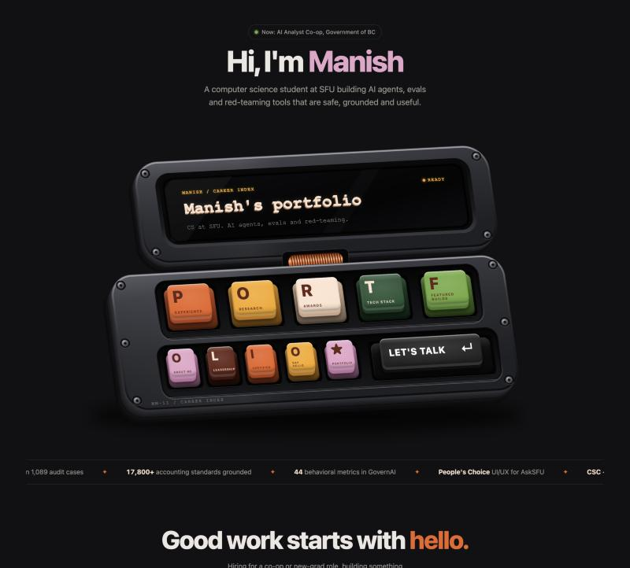

# Portfolio Console

**The personal portfolio of Manish Madishetty**, built as a retro-futurist mechanical keyboard console. The keycaps spell **P-O-R-T-F-O-L-I-O**. Press one and it opens a section of my work: industry experience, research, competition wins, featured builds, leadership and certifications.

**Live site: [manmad-web.github.io/portfolio-console](https://manmad-web.github.io/portfolio-console/)**

[](https://manmad-web.github.io/portfolio-console/)

> Computer Science (Statistics minor) at Simon Fraser University · AI Analyst Co-op at the Government of BC · building AI agents, evaluations and red-teaming tools that are safe, grounded and useful.

---

## Contents

- [Features](#features)
- [Keymap](#keymap)
- [What's inside](#whats-inside)
- [Run it locally](#run-it-locally)
- [Deploy to GitHub Pages](#deploy-to-github-pages)
- [Editing content](#editing-content)
- [How the console is built](#how-the-console-is-built)
- [Accessibility](#accessibility)
- [Browser support](#browser-support)
- [Credits](#credits)
- [License](#license)

## Features

- **A 3D console drawn entirely in code.** The extruded graphite case, recessed key trays, copper coil hinge, countersunk screws and glass screen are inline SVG. No image assets are needed.
- **Mechanical keycaps.** Each key is a real HTML control with a tactile face, a sidewall and a contact shadow. Keys spring up on hover, snap down when pressed and ripple in an idle wave every 7 seconds.
- **Typing terminal.** The screen types its title one character at a time with an amber caret. Hovering or focusing a key types where that key leads. A new request always cancels unfinished typing, so text never interleaves.
- **Section dialogs.** A native modal `<dialog>` handles Escape to close, click-outside to close, focus trapping and focus return to the key that opened it.
- **One shared coordinate system.** The case, wells, keys and screen all live on a single 1536 × 1024 artboard, so they scale together and never drift apart at any viewport width.
- **Lightweight.** Plain HTML, CSS and JavaScript, with no framework and no build step. The only external request is the Figtree font from Google Fonts.

## Keymap

| Key | Label | Opens |
| --- | --- | --- |
| **P** | Experience | AI Analyst Co-op (Connected Services BC) · AI Engineer Intern (TechVest Global) |
| **O** | Research | Undergraduate Researcher, SFU · Research Assistant, Fairleigh Dickinson University |
| **R** | Awards | 1st Place Catalyst Challenge · UI/UX People's Choice (AskSFU) · Second Runner-up Top Idea Prize (ZENJI) |
| **T** | Tech stack | Everything I've used: languages, AI/ML, web, data and infrastructure, AI-assisted dev, product and design |
| **F** | Projects | All projects once each: IntelliAudit · SignShield · audit agent · red-teaming service · GovernAI · AskSFU · Moment Intelligence · SFSS Nexus · ZENJI · Rate CS Staff · this site |
| **O** | About me | Education at SFU and a short bio |
| **L** | Leadership | SFSS Associate VP · FAS Ambassador · Calculus Peer Mentor · PennyDrops Financial Literacy Mentor |
| **I** | Certified | Canadian Securities Course · Bloomberg Market Concepts · Certified ScrumMaster |
| **O** | Say hello | Contact section |
| **★** | Portfolio | Full timeline, 2023 to today |
| **↵** | Let's talk | Contact section |

The top navigation mirrors the main sections, so the site stays easy to use on phones where the keys are small.

## What's inside

```
portfolio-console/
├── index.html              Page markup, the SVG case, and the section content (<template> blocks)
├── assets/
│   ├── css/
│   │   └── styles.css      Layout, keycap 3D styling, screen typography, motion
│   └── js/
│       ├── keymap.js       Every key: position, colours, label, destination, screen text
│       └── console.js      Builds the 3D case and keycaps; typing engine, idle wave, dialogs
├── docs/
│   ├── design-notes.md     Coordinate system, key fit table and motion spec
│   └── preview.jpg         Screenshot used in this README
├── LICENSE
└── README.md
```

## Run it locally

No install is needed. Serve the folder with any static file server:

```bash
python3 -m http.server 8000
```

Then open <http://localhost:8000>. You can also open `index.html` directly in a browser.

## Deploy to GitHub Pages

This repo is already published with GitHub Pages from the `main` branch root, at <https://manmad-web.github.io/portfolio-console/>. Every push to `main` redeploys it automatically within about a minute.

To publish a fork, go to **Settings → Pages**, choose **Deploy from a branch**, then pick `main` and `/ (root)`. Netlify, Vercel and Cloudflare Pages also work as-is: point them at the repository root with no build command.

## Editing content

| To change… | Edit |
| --- | --- |
| Section content (roles, awards, projects…) | The `<template id="t-…">` blocks at the bottom of `index.html` |
| Key labels, colours, screen text or destinations | `assets/js/keymap.js` |
| The welcome line on the screen | `showWelcome()` in `assets/js/console.js` |
| Contact email and links | The `#contact` section in `index.html` |
| Highlights strip | The `.strip` list in `index.html` (both copies) |

The name in the "Hi, I'm Manish" heading can be clicked and edited by a visitor. That edit is saved only in their own browser through `localStorage`. It never changes the published site.

## How the console is built

- **Case.** `index.html` defines the lid and base outlines once. `console.js` extrudes each one by stacking about 25 offset copies, stepping down and to the left with a dark-to-lit gradient and a seam line. That stack is what gives the case its thickness.
- **Trays and wells.** The two recessed trays are sized from the keys they hold. `console.js` converts each key's centre into the base plate's local frame (the inverse of its rotate and skew) and wraps the row with padding.
- **Keycaps.** Each key is anchored in its well with `rotate(-3.2deg) skewX(4.8deg)`. Only the inner face moves. It rises by a registered CSS custom property, `--lift`, and stacked `box-shadow`s draw its sidewall at whatever height it has. Because the hit area never moves, hovering can't flicker.
- **Screen.** The text box shares the lid's `rotate(-3deg) skewX(5deg)` so it sits inside the glass. Layered `text-shadow`s give the Courier lettering its extruded, embossed depth.

More detail, including the full key fit table, is in [`docs/design-notes.md`](docs/design-notes.md).

## Accessibility

- Content keys are real `<button>`s and contact keys are real links, with visible focus outlines.
- Each key has a full accessible name, such as "R: Competition wins".
- The screen heading keeps its complete `aria-label` while its characters animate, so screen readers never hear the text letter by letter.
- `prefers-reduced-motion` turns off the key pops, the wave, the marquee and the blinking caret, and shows full text immediately.
- No audio and no autoplaying media.

## Browser support

Current versions of Chrome, Edge, Safari and Firefox. The site uses container query units (`cqw`), `@property`, `color-mix()` and `<dialog>`, which all of these support.

## Credits

- Concept and visual brief: *The Portfolio Console* design handoff by Debbie, adapted here with my own content.
- Typeface: [Figtree](https://fonts.google.com/specimen/Figtree) (SIL Open Font License); screen type is Courier New.

## License

The code is released under the [MIT License](LICENSE). The written portfolio content (my experience, research and awards) is © Manish Madishetty. Please don't reuse it as your own.

---

**Manish Madishetty** · Vancouver, Canada · [LinkedIn](https://www.linkedin.com/in/manishmadishetty) · mma310@sfu.ca
